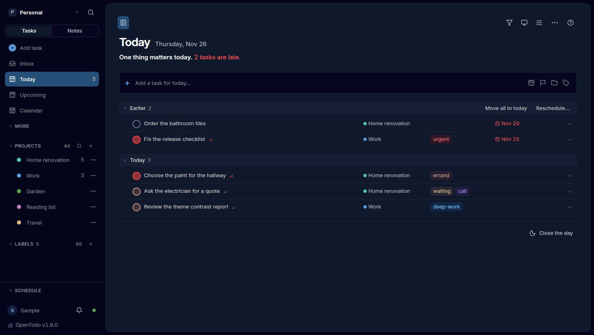

# Deepwick for OpenTodo

Deepwick colors for [OpenTodo](https://github.com/OpenTodoApp/OpenTodo), the
self-hosted task manager. Dark only.

> Deepwick is an unofficial theme derived from
> [Polywick Blue](https://vscode.polywickstudio.net) by Polywick Studio (MIT).
> Not affiliated with Polywick Studio.

## Install

1. Download [`deepwick.opentodo-theme.json`](deepwick.opentodo-theme.json).
2. In OpenTodo, open **Settings → Appearance → Theme and density**.
3. Under **Your themes**, choose **Import → Theme file** and pick the file (or
   drop it onto **Your themes**). The theme opens in the editor; choose
   **Save**.
4. Set the mode to **Dark** (or **System**) and choose **Deepwick** in the
   **Dark** list.

Your themes sync to your other devices.

## Colors

The mapping follows OpenTodo's own
[mapping for editor palettes](https://github.com/OpenTodoApp/OpenTodo/blob/main/web/src/lib/theme/builtin/MAPPING.md).

| OpenTodo                        | Deepwick role |
| ------------------------------- | ------------- |
| Canvas, sidebar, browser bar    | Background    |
| Surface (cards, rows, dialogs)  | Surface       |
| Text / strong text              | Foreground / White |
| Accent, accent text             | Blue          |
| Selected item                   | Selection     |
| Search highlight                | Gold          |
| Input border                    | Muted         |
| Success / warning / danger / info | Green / Yellow / Red / Cyan |
| Priorities 1 / 2 / 3 / 4        | Red / Orange / Blue / Comment |

Label colors, by nearest hue:

| Label  | Deepwick role | Label | Deepwick role |
| ------ | ------------- | ----- | ------------- |
| red    | Red           | teal  | Teal          |
| orange | Orange        | cyan  | Cyan          |
| yellow | Gold          | blue  | Blue          |
| lime   | Mint          | pink  | Magenta       |
| green  | Green         | slate | Comment       |

OpenTodo derives every other color (raised surfaces, popovers, hover,
borders, muted and faint text, soft chips) from these, and moves each derived
color until it passes OpenTodo's contrast check. The theme passes every pair.

The file is generated by `generate.py` from the Deepwick palette.

## Notes

- OpenTodo's mapping puts the editor background on cards. Deepwick uses its
  lighter surface for cards and the background for the page around them, as
  OpenTodo Dark does, so cards stand out.
- Priorities, the search highlight and the input border are set from the
  palette rather than derived, so they keep Deepwick's colors.
- Deepwick has no indigo or violet, so those two label colors are OpenTodo's
  own.
- Muted and faint text are derived, not Deepwick's muted and comment colors:
  those are below 4.5:1 on OpenTodo's cards, popovers and tinted rows.
- OpenTodo lightens the danger color slightly so it stays readable on a
  selected row. Priority 1 and the red label keep Deepwick red.

Tested with OpenTodo 1.9.0.

## License

MIT. See [LICENSE](LICENSE).
